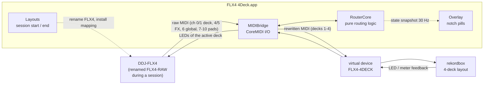
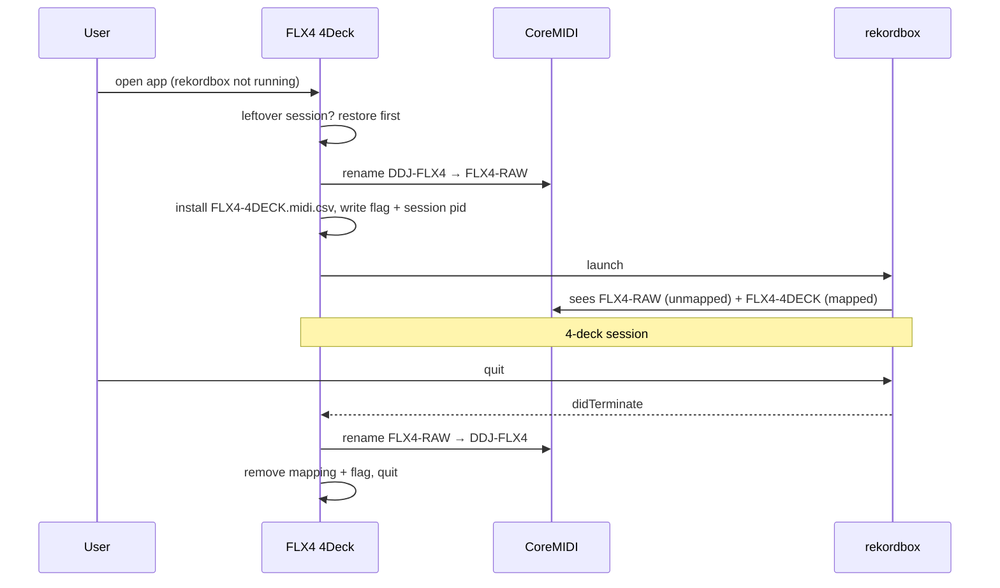

# Architecture

FLX4 4Deck is a small macOS menu-bar app (Swift, AppKit + CoreMIDI, no dependencies) that sits
between the DDJ-FLX4 and rekordbox and turns the 2-channel controller into a 4-deck one.

## Big picture

rekordbox never talks to the FLX4 directly during a session. It sees two MIDI devices:

- **FLX4-RAW**: the real FLX4 under a different name. rekordbox has no mapping for it, so it ignores
  its MIDI (but the hardware unlock still works).
- **FLX4-4DECK**: the router's virtual device, mapped by `Resources/mappings/FLX4-4DECK.midi.csv`.

Why the rename is needed, and why the jog works the way it does, is explained in
[REKORDBOX-NOTES.md](REKORDBOX-NOTES.md).

## Source layout

| Path | Role |
|---|---|
| `Sources/FLX4Deck/RouterCore.swift` | All routing decisions. No CoreMIDI, no clock except an injectable `clock` closure, so it is fully unit-testable. |
| `Sources/FLX4Deck/MIDIBridge.swift` | CoreMIDI plumbing: finds the FLX4 by its USB model string, publishes the virtual device, parses packets (running status, sysex skip), sends batches, runs the 20 ms jog timer. |
| `Sources/FLX4Deck/Layouts.swift` | Session start/end: rename the FLX4's MIDI objects, install/remove the virtual mapping, repair a leftover rename. |
| `Sources/FLX4Deck/Overlay.swift` | Two borderless, non-activating panels beside the notch (or free-floating), drawn by hand. |
| `Sources/FLX4Deck/App.swift` | Menu-bar app: session lifecycle, rekordbox launch/quit watching, menu, logging. |
| `Sources/FLX4Deck/SelfTest.swift` | `--selftest`: routing tests against `RouterCore`. |
| `Sources/FLX4Deck/main.swift` | Entry point; `--selftest`, `--sniff` (headless + log every message), `--headless`. |
| `tools/gen_mappings.py` | Builds `FLX4-4DECK.midi.csv` from rekordbox's bundled FLX4 default. |
| `tools/make_icon.swift` | Renders the app icon. |
| `tests/e2e.swift` | CoreMIDI end-to-end test with a fake FLX4 and a fake rekordbox. |
| `build.sh` | Regenerate mapping → build → self-test → (e2e) → bundle → sign ad hoc → DMG. |

## Threads and locking

- CoreMIDI delivers input on its own high-priority thread. `MIDIBridge.receive` parses the packet,
  calls `RouterCore` under an `NSLock`, and sends the results straight away; there is no queue hop
  on the hot path.
- A 20 ms `DispatchSourceTimer` calls `RouterCore.jogIdle()` (ends jog holds, refreshes play state).
- The UI reads a snapshot (`MIDIBridge.snapshot()`) at 30 Hz on the main thread.
- Logging is appended on a utility queue so file I/O never delays MIDI.

## RouterCore

State, per side (0 = left, 1 = right) or per deck (0-3):

| State | Purpose |
|---|---|
| `active[side]` | Deck each side controls (0/2 left, 1/3 right). |
| `leds[deck]` | Last LED/indicator value rekordbox sent for each FLX4 address, replayed on swap. |
| `phys[side]`, `deckVal[deck]`, `pickup[side]` | Soft takeover for absolute controls (tempo, trim, EQ, fader, CFX). |
| `held` | Where each pressed button was routed, so its release goes to the same place after a swap or after SHIFT is let go. |
| `jogNote`, `jogDeck`, `jogLast` | The nudge/search button currently held for each jog. |
| `playLED`, `playLastOff` | Play LED tracking; steady on = playing, blinking = paused. |
| `shiftHeld` | SHIFT state, used by the Beat FX channel select. |

### Input (FLX4 → rekordbox)

1. **Release of a held button:** routed to wherever its press went (`held`).
2. **Swap combos:** SHIFT + headphone CUE (`0x68` on ch 0/1) toggles that side; MASTER CUE (`0x63`
   on ch 6) toggles both. Consumed, never forwarded.
3. **Jog** (`B0/B1` CC `0x21`, `0x22`, `0x23`, `0x29`): see *Jog emulation* below.
4. **Absolute deck controls:** moved to the active deck's channel, gated by soft takeover.
5. **Other deck controls and pads:** channel rewritten to the active deck.
6. **LOAD and CFX knobs** (global channel, but per deck): note/CC number shifted by the deck.
7. **Beat FX channel select** (`9x 10/11` on ch 4/5): CH1/CH2, or CH3/CH4 with SHIFT.
8. **Everything else** (browser, crossfader, FX unit, master): forwarded unchanged.

The exact addresses are in [MIDI-MAP.md](MIDI-MAP.md).

### Feedback (rekordbox → FLX4)

rekordbox sends LEDs and meters for all 4 decks to the virtual device. Each message is translated
to the FLX4 address of the side that deck belongs to and cached in `leds[deck]`. It is only sent
to the FLX4 when that deck is the side's active deck. On a swap the router clears LEDs that only
the old deck had and replays the new deck's cache, so pads, play/cue, loop and load lights match
the deck you now control. Channel level meters are not cached (they would replay stale values).

### Soft takeover (pickup)

On a swap, every absolute control whose physical position differs from the new deck's last known
value by more than 3 steps is put into pickup. Its messages are dropped until the physical value
gets within 3 steps of the target or crosses it. LSB messages follow their MSB's state. Decks whose
value is unknown (never touched in this session) take the physical value immediately.

### Jog emulation

rekordbox ignores jog-type input from unrecognised devices, so jog movement is turned into
buttons that do work:

| Situation | Button held while the wheel turns |
|---|---|
| Outer edge (`0x21`) or touched pitch bend (`0x23`) on a **playing** deck | `PitchBendUp/Down` (nudge, about ±8% speed) |
| Platter touched (`0x22`), SHIFT + jog (`0x29`), or a **stopped/paused** deck | `SearchFwd/Rev` (rekordbox accelerates the longer it is held) |

The button is pressed on the first tick and released 80 ms after the last tick (`jogIdle`). A
direction or mode change releases the old button first; a swap releases it on the old deck.
"Playing" means the play LED is on and has not gone off in the last 0.7 s (it blinks when paused).

## Session lifecycle

- **Resume:** if the app is reopened while rekordbox is still running with the session's pid, it
  just reattaches.
- **rekordbox opened directly:** the overlay says so; the FLX4 is untouched, normal 2-channel mode.
- **Crash / force quit:** the next app launch sees the flag or the `FLX4-RAW` name and restores
  before starting a new session. *Restore FLX4 to 2-Channel Mode* in the menu does the same by hand.
- The FLX4 user mapping (`DDJ-FLX4.midi.csv`) is never read or written.

State lives in `~/Library/Application Support/FLX4-4Deck/` (`4deck-installed`, `session-pid`) and the
log in `~/Library/Logs/FLX4-4Deck.log`.

## Overlay

Two `NSPanel`s at `mainMenu + 2` level, `canJoinAllSpaces + fullScreenAuxiliary`, so they stay
visible over fullscreen rekordbox. In *Beside Notch* mode they are placed using
`NSScreen.auxiliaryTopLeftArea/RightArea` and the notch height. *Free* mode lets you drag the pair
(position saved). Sizes scale everything from the pill height. A click on a deck tile selects that
deck; a swap makes the side's border glow for 0.5 s.

## Testing

| Layer | How |
|---|---|
| Routing logic | `FLX4Deck --selftest` (run by every build) |
| CoreMIDI plumbing | `./build.sh --test`: `tests/e2e.swift` publishes a fake FLX4, runs the router headless against it and acts as rekordbox on the virtual device |
| rekordbox behaviour | Manual: inject MIDI on a virtual `FLX4-4DECK` and read rekordbox's screen (how the findings in REKORDBOX-NOTES.md were made) |
| Hardware | `--sniff` or *Log MIDI Messages* records every message in and out |
